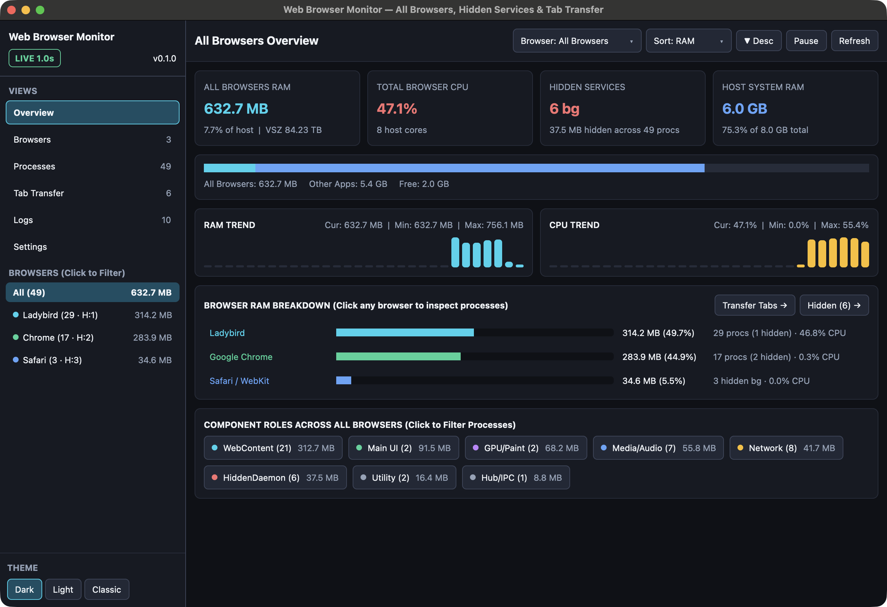
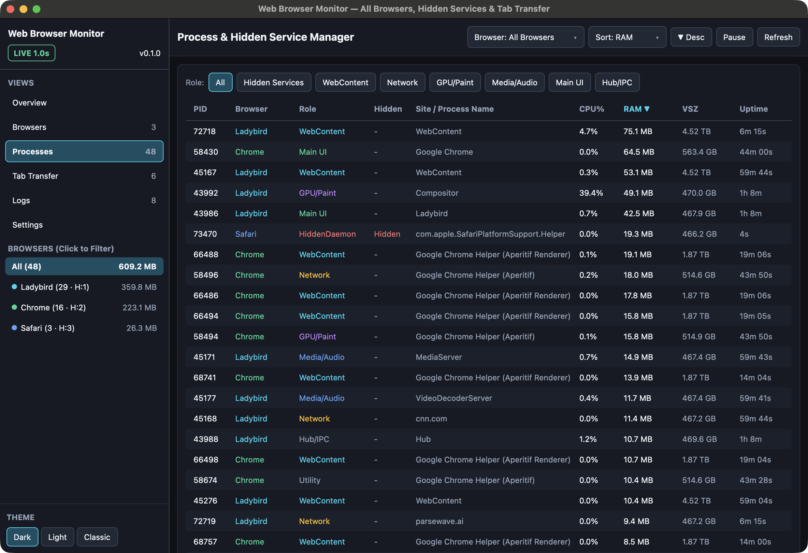
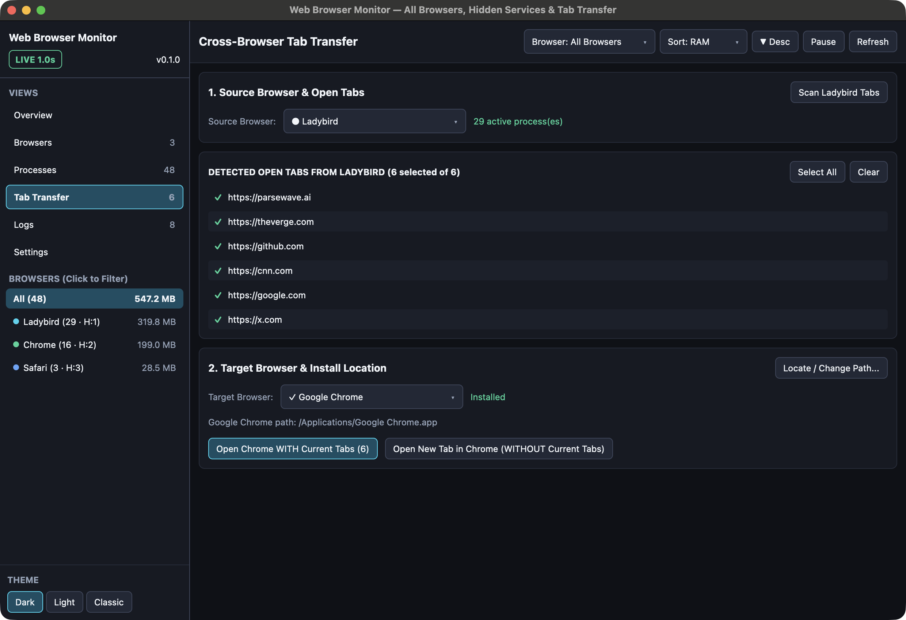
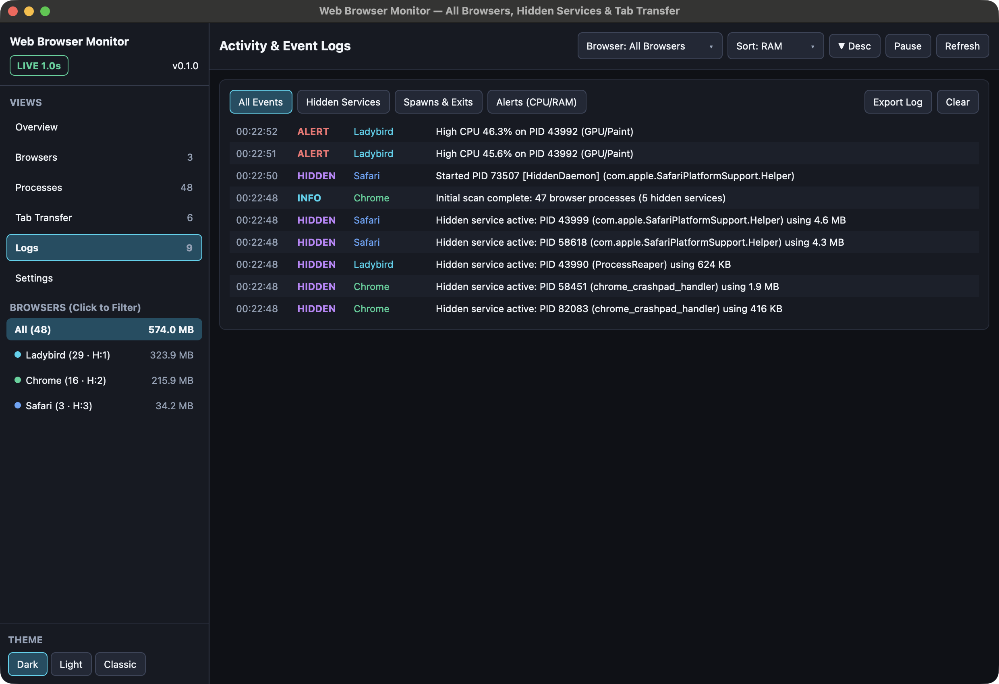
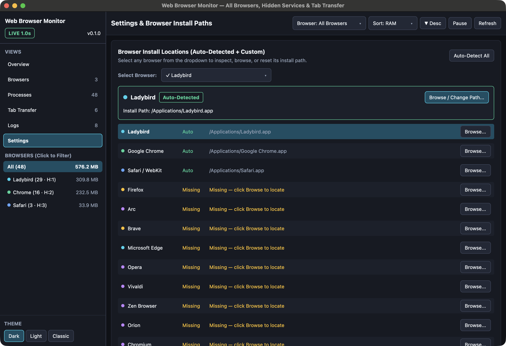
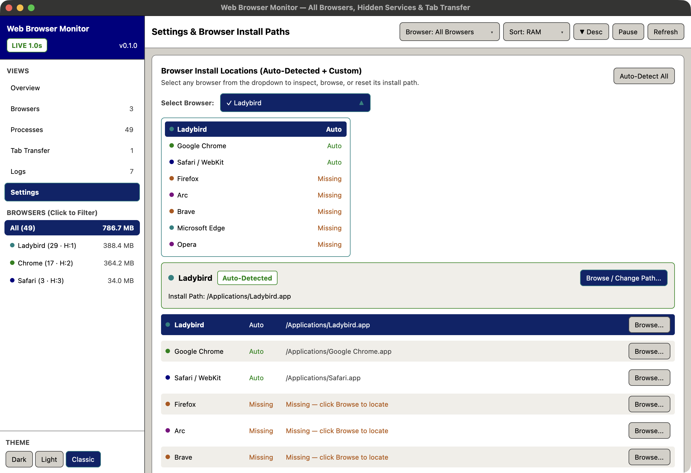
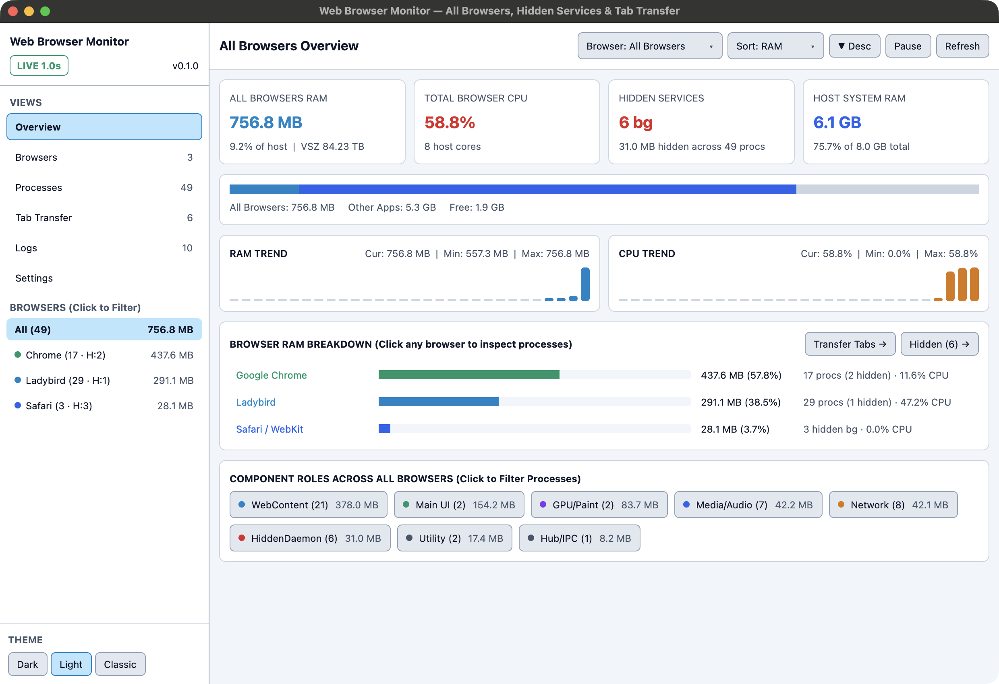
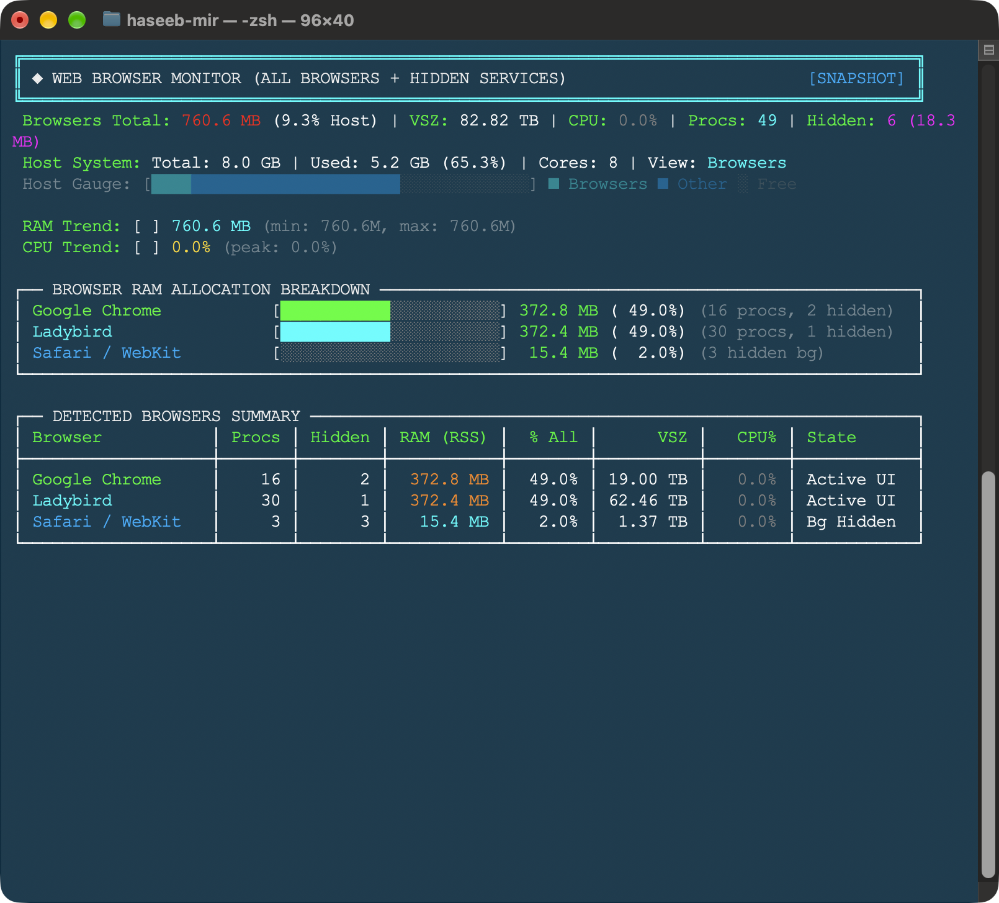

# Web Browser Monitor

A **100% Rust** real-time process, memory, hidden-service, and cross-browser tab monitor for **all major web browsers** — featuring both a colorful **CLI / Terminal TUI** (`web-browser-monitor`) and a GPU-accelerated **GPUI Desktop GUI** (`web-browser-monitor-gui`).

> **Platform Support:** Tested on **macOS** (Apple Silicon). Built in cross-platform Rust (`sysinfo`, `crossterm`, `gpui-kit`) and works across **macOS, Linux, and Windows**.

---

## Why Use Web Browser Monitor Instead of Activity Monitor or Task Manager?

Standard OS monitors (macOS **Activity Monitor** and Windows **Task Manager**) bury or hide critical browser background activity:

1. **Hidden Background Services & XPC Daemons:** Browsers silently keep background helpers running **even after you close every window** — e.g. Apple WebKit/Safari XPC helpers (`SafariPlatformSupport.Helper`, `CacheDeleteExtension`, `com.apple.WebKit.*`), Chrome/Brave Crashpad handlers & auto-updaters (`GoogleUpdater`), and multi-process daemons (`ProcessReaper`, `Hub`). `web-browser-monitor` surfaces and groups them with a dedicated **Hidden** counter and filter.
2. **Unified Multi-Browser Breakdown:** See **Ladybird, Google Chrome, Safari/WebKit, Firefox, Arc, Brave, Microsoft Edge, Opera, Vivaldi, Zen, Orion, and Chromium** side by side, grouped by browser AND by internal component role (`WebContent`, `Network`, `GPU/Compositor`, `Media/Audio`, `ImageDecoder`, `Plugin/Extension`, `Hub/IPC`, `HiddenDaemon`).
3. **Real-Time Activity & Alert Logs:** Tracks process spawns, exits, hidden daemon detections, RAM spikes (`>= +50 MB`), and high CPU alerts (`> 45%`) with live filtering and `.log` export.
4. **Cross-Browser Tab Transfer:** Scan open tabs from one browser and open them in any other browser (**with** current tabs or a fresh **new tab without** current tabs), using auto-detected or custom browser install locations.

---

## Screenshots

### Desktop GUI — All Browsers Overview (`web-browser-monitor-gui`)


### Desktop GUI — Sortable Process & Hidden Service Manager


### Desktop GUI — Cross-Browser Tab Transfer & Activity Logs
| Cross-Browser Tab Transfer | Real-Time Activity & Hidden Service Logs |
| :---: | :---: |
|  |  |

### Desktop GUI — Settings, Browser Dropdown & Install Paths
| Browser Dropdown & Install Path Settings | Classic Theme (`--theme classic`) with Open Browser Dropdown |
| :---: | :---: |
|  |  |

### Desktop GUI — Light Theme (`--theme light`)


### Terminal CLI / TUI (`web-browser-monitor`)


---

## Two Standalone Apps Included

| Binary | Type | Highlights |
| :--- | :--- | :--- |
| `web-browser-monitor` | CLI / TUI | Terminal live monitor with ANSI colors, bar charts, sparklines, snapshot & JSON modes, browser path management, and CLI tab transfer |
| `web-browser-monitor-gui` | Desktop GUI | GPUI desktop app with sidebar navigation (`Overview`, `Browsers`, `Processes`, `Tab Transfer`, `Logs`, `Settings`), interactive **Browser & Sort dropdown menus**, sortable columns, process inspector (`Copy PID`, `Copy Cmd`, `Kill Process`), Source/Target browser dropdowns for tab transfer, Settings browser selector with native path picker, and **Dark / Light / Classic** themes |

---

## How to Build

Requires [Rust](https://rustup.rs/) (Cargo + `rustc`).

```sh
git clone https://github.com/haseeb-heaven/web-browser-monitor.git
cd web-browser-monitor

# Build both CLI and GPUI GUI release binaries
cargo build --release --all-targets

# Or build CLI only (fast, lightweight, no GUI dependencies)
cargo build --release --no-default-features --bin web-browser-monitor
```

Compiled binaries are located at:
- `target/release/web-browser-monitor` (CLI)
- `target/release/web-browser-monitor-gui` (GUI)

---

## How to Run

### Run the Desktop GUI
```sh
./target/release/web-browser-monitor-gui

# Launch directly into a specific theme or tab:
./target/release/web-browser-monitor-gui --theme light
./target/release/web-browser-monitor-gui --theme classic --tab settings
./target/release/web-browser-monitor-gui --tab transfer
./target/release/web-browser-monitor-gui --tab logs
```

### Run the CLI
```sh
# Live interactive TUI dashboard (1s refresh)
./target/release/web-browser-monitor

# One-shot colored snapshot and exit
./target/release/web-browser-monitor --once

# Process list, component roles, or live event logs
./target/release/web-browser-monitor -p --once
./target/release/web-browser-monitor -c --once
./target/release/web-browser-monitor -l --once

# Filter by browser & write logs to a file
./target/release/web-browser-monitor --browser chrome --log-file ~/Downloads/browsers.log

# Machine-readable JSON output
./target/release/web-browser-monitor --json
```

### Cross-Browser Tab Transfer & Install Paths (CLI)
```sh
# List auto-detected & custom install paths for all 12 browsers
./target/release/web-browser-monitor --browsers-paths

# Save a custom install location
./target/release/web-browser-monitor --set-path firefox "/Applications/Firefox.app"

# Open all current tabs from Ladybird in Chrome (prompts for path if missing)
./target/release/web-browser-monitor --transfer ladybird chrome

# Open a fresh tab/window in Safari WITHOUT transferring current tabs
./target/release/web-browser-monitor --open-browser safari --new-tab
```

**CLI Live Mode Hotkeys:** `q` / `Esc` Quit · `t` Cycle Views (`Browsers`/`Components`/`Processes`/`Logs`) · `b` Cycle Browser Filter · `s` Cycle Sort · `Space` Pause · `+`/`-` Speed · `r` Refresh

---

## Run Tests

```sh
cargo test
```

---

## License

MIT — see [LICENSE](LICENSE).
